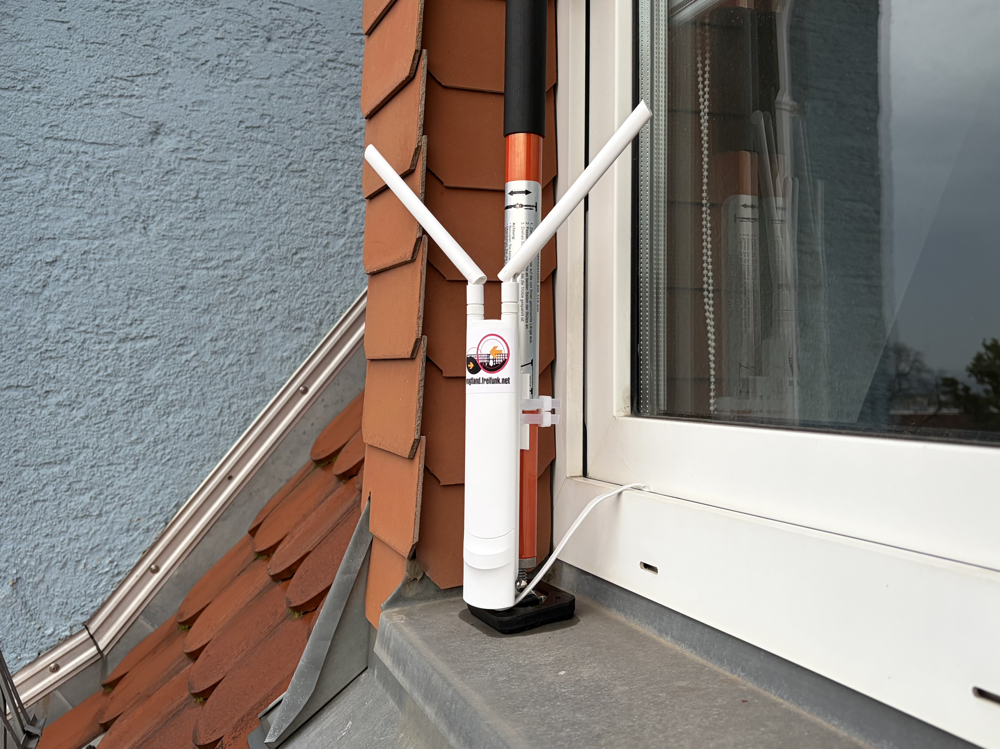

# Freifunk Vogtland – Hardware-Dokumentation

Dokumentation der Hardware und technischen Aufbauten im Freifunk-Vogtland-Netz.

## Installationen mit Offloadern

- [TP-Link EAP225 Outdoor mit physischem x86-64-Offloader](guides/offloader/physical/README.md)
- [x86-64-Offloader unter Proxmox VE](guides/offloader/proxmox/README.md)

  
   
  <em>TP-Link EAP225 Outdoor V3.20, mit einer Fensterhalterung für SAT-Geräte im Fensterbereich befestigt.</em>

## Geplante Funkstrecken

- [Richtfunkverbindung zu einem Garagenkomplex](planning/wireless-link/README.md) – ca. 300 m, aktuell werden ein **separater Offloader oder Freifunk-Firmware auf den Richtfunkgeräten** als mögliche Varianten geprüft.

## Router

- [AVM FRITZ!Box 4020](hardware/routers/avm/fritzbox-4020/README.md)