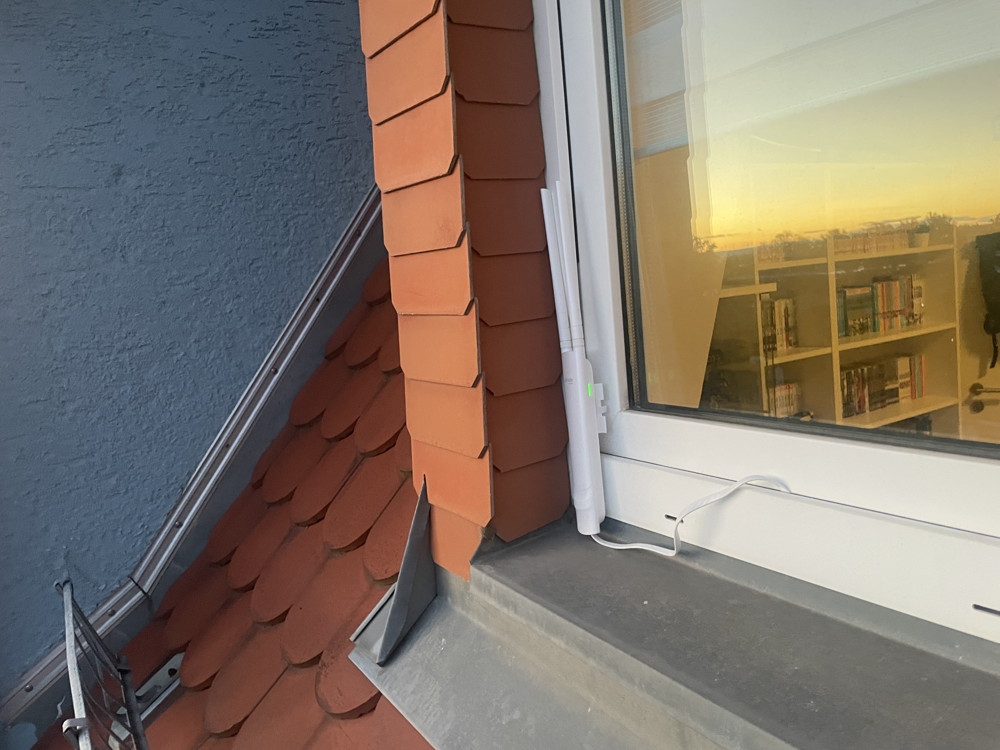
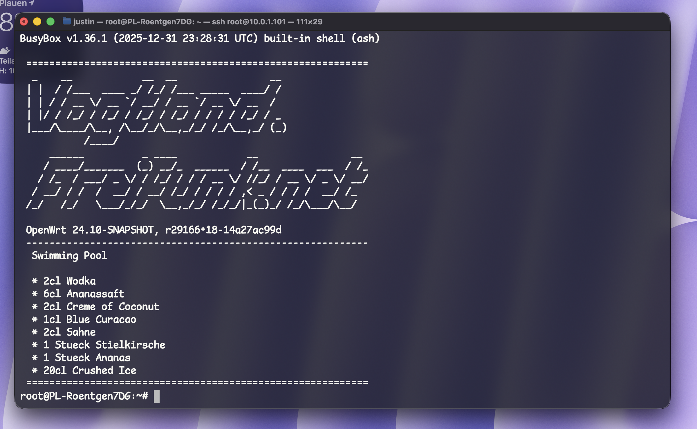

# FFV – Aufbau eines x86-64-Offloaders mit externem Access Point

## 1. Ziel und Ausgangssituation

Ziel dieses Aufbaus ist es, einen leistungsfähigen Freifunk-Vogtland-Knoten bereitzustellen, bei dem die Freifunk-Funktionalität auf einem separaten x86-64-Offloader ausgeführt wird, während der WLAN-Access-Point mit seiner originalen Hersteller-Firmware betrieben wird.

Der Ausgangspunkt ist ein TP-Link EAP225 Outdoor mit Hardware-Revision V3.20, auf dem die originale TP-Link-Omada-Firmware 5.2.4 Build 20251024 Rel. 63790(4555) installiert ist. In dieser konkreten Hardware- und Firmware-Konstellation lässt sich Gluon nicht wie benötigt direkt auf dem Access Point installieren. Daher wird die Freifunk-Funktionalität auf einen separaten Rechner ausgelagert.

Der Access Point wird bewusst weder mit Gluon noch mit einer anderen alternativen Firmware geflasht. Stattdessen bleibt die originale Omada-Firmware erhalten und der EAP225 wird ausschließlich als WLAN-Access-Point eingesetzt. Die eigentliche Freifunk-Funktionalität übernimmt ein eigenständiger x86-64-Rechner, auf dem Gluon für das Freifunk-Vogtland-Netz installiert wird.

Weitere Informationen zur Hardware und zu den verfügbaren Firmware-Optionen finden sich beispielsweise in der OpenWrt-Hardware-Datenbank zum TP-Link EAP225.

Die Unterstützung eines Geräts durch Gluon hängt unter anderem von der Hardware-Revision und der vorgesehenen Installationsmethode ab. Angaben zur Unterstützung anderer Revisionen oder Installationsvarianten lassen sich deshalb nicht ohne Weiteres auf das hier vorhandene Gerät übertragen.

<p align="center">
  
  <br>
  <sub><em>TP-Link EAP225 Outdoor V3.20, unauffällig und provisorisch im Fensterbereich befestigt.</em></sub>
</p>

Da der Access Point bereits mit der originalen Omada-Firmware zuverlässig funktioniert, bleibt er in diesem Aufbau unverändert. Dadurch entfällt das Risiko eines Firmware-Flashs und die Möglichkeit bleibt erhalten, den EAP225 künftig unabhängig vom Freifunk-Projekt oder in einer anderen Netzwerkinfrastruktur weiterzuverwenden.

Als Offloader kommt ein älterer Rechner zum Einsatz, der noch vorhanden war und für diesen Zweck weiterverwendet wird:

- **Hardware:** Lenovo ThinkCentre M700
- **CPU:** Intel Core i5-6500
- **Arbeitsspeicher:** 8 GB RAM
- **Speicher:** 240 GB SSD
- **Netzwerk:** integrierte Ethernet-Schnittstelle und zusätzliche Ethernet-Schnittstelle
- **Software:** Freifunk Vogtland Gluon für x86-64

Der ThinkCentre übernimmt die Freifunk-Funktionalität, während der EAP225 ausschließlich die WLAN-Versorgung bereitstellt. Damit werden die Aufgaben klar getrennt: Der Offloader stellt die Freifunk-Netzwerkfunktionen bereit, der Access Point dient als Schnittstelle für die WLAN-Clients.

Die folgenden Abschnitte beschreiben die Installation und Konfiguration des physischen Offloaders sowie die anschließende Integration des TP-Link EAP225 Outdoor in den Freifunk-Knoten.

## 2. Inbetriebnahme des Offloaders

### Schritt 1: Debian Live starten

Einen bootfähigen Debian-Live-USB-Stick erstellen, beispielsweise mit Rufus. Anschließend den Offloader vom USB-Stick starten und eine funktionierende Internetverbindung herstellen.

### Schritt 2: Freifunk-Image herunterladen

In diesem Beispiel wird das folgende Freifunk-Vogtland-Image verwendet:

`gluon-ffv-b20260506-x86-64.img.gz`

Offizieller Download:

https://firmware.freifunk-vogtland.net/firmware/stable/factory/gluon-ffv-b20260506-x86-64.img.gz

### Schritt 3: Image überprüfen und entpacken

Ein Arbeitsverzeichnis erstellen und das Image herunterladen:

```bash
mkdir -p ~/Downloads/ffv
cd ~/Downloads/ffv

wget https://firmware.freifunk-vogtland.net/firmware/stable/factory/gluon-ffv-b20260506-x86-64.img.gz
```

Die heruntergeladene Datei überprüfen:

```bash
gzip -t gluon-ffv-b20260506-x86-64.img.gz
```

Der Befehl prüft, ob die komprimierte Datei fehlerfrei gelesen werden kann.

Anschließend das Image entpacken:

```bash
gzip -dk gluon-ffv-b20260506-x86-64.img.gz
```

Die Option `-d` entpackt die Datei; `-k` erhält die ursprüngliche komprimierte Datei.

### Schritt 4: SSD identifizieren

Vor dem Schreiben des Images muss der richtige Datenträger eindeutig identifiziert werden:

```bash
lsblk -o NAME,SIZE,MODEL,TYPE,MOUNTPOINTS
```

Anhand von Gerätename, Größe und Modell die interne SSD bestimmen. Der Gerätename kann beispielsweise `/dev/sda` oder `/dev/nvme0n1` lauten.

**Wichtig:** Als Ziel muss der gesamte Datenträger angegeben werden, nicht eine einzelne Partition.

### Schritt 5: Gluon auf die interne SSD schreiben

**WARNUNG:** Der folgende Befehl überschreibt den ausgewählten Datenträger vollständig. Alle vorhandenen Daten auf diesem Datenträger gehen verloren. Vor der Ausführung unbedingt die Ausgabe von `lsblk` prüfen.

```bash
sudo dd if="$HOME/Downloads/ffv/gluon-ffv-b20260506-x86-64.img" of=/dev/<Laufwerk> bs=4M status=progress conv=fsync
```

`<Laufwerk>` muss durch den tatsächlichen Gerätenamen ersetzt werden, beispielsweise `/dev/sda`.

Der Befehl schreibt das Gluon-Image auf den Datenträger und wartet mit `conv=fsync` darauf, dass die Schreibvorgänge abgeschlossen sind.

### Schritt 6: Rechner neu starten

Nach erfolgreichem Abschluss den Rechner herunterfahren, den Debian-USB-Stick entfernen und den Offloader von der internen SSD starten.

Nach der Installation werden die Netzwerkschnittstellen entsprechend ihrer Funktion zugeordnet. In der Gluon-Konfiguration können unter anderem folgende Bridges vorkommen:

- `br-wan` – WAN-seitige Bridge für die Verbindung zum bestehenden Netzwerk beziehungsweise zum Internet-Uplink.
- `br-client` – Client-seitige Bridge für die Verbindung zum Freifunk-Netz beziehungsweise zu angeschlossenen Access Points.

Die tatsächliche Zuordnung der physischen Ethernet-Schnittstellen muss anhand der Netzwerkkonfiguration des installierten Images geprüft werden. Bridge-Namen sind nicht mit den Namen der physischen Ethernet-Ports gleichzusetzen.

## 3. Zugriff und Konfiguration des Knotens

### Schritt 1: Konfigurationsmodus starten

Für die Konfiguration des Knotens gibt es zwei Möglichkeiten: Die Einstellungen können entweder über die Gluon-Weboberfläche im Konfigurationsmodus vorgenommen werden oder alternativ über die CLI – lokal am Gerät oder per SSH – mit UCI konfiguriert werden.

Der einfachste Weg ist in der Regel die Weboberfläche. Dazu wird der Knoten in den Konfigurationsmodus versetzt. Anschließend kann die Konfigurationsoberfläche über http://192.168.1.1 aufgerufen werden.

Der Konfigurationsmodus kann alternativ über die CLI mit folgendem Befehl aktiviert werden:

```bash
gluon-enter-setup-mode
```

Anschließend startet der Knoten neu.

Im Konfigurationsmodus stellt der Knoten üblicherweise die Adresse `192.168.1.1` bereit. Ein angeschlossenes Gerät kann eine Adresse aus dem Netzwerk `192.168.1.0/24` erhalten. Die Konfigurationsoberfläche ist dann über folgende Adresse erreichbar:

http://192.168.1.1

Die genaue Erreichbarkeit hängt von der aktiven Konfiguration und der verwendeten Verbindung ab.

Alternativ können Knoteneinstellungen per SSH und UCI vorgenommen werden. In dieser Anleitung wird dafür der vollständige Pfad `/sbin/uci` verwendet.

<p align="center">
  
  <br>
  <sub><em>SSH-Zugriff auf den Offloader.</em></sub>
</p>

### Schritt 2: Knoteneinstellungen festlegen

Die folgenden Befehle zeigen beispielhaft, wie Hostname, Standort und Kontaktadresse konfiguriert werden.

#### Hostname festlegen

Legt den Namen des Freifunk-Knotens fest.

```bash
/sbin/uci set system.@system[0].hostname='<hostname>'
```

#### Standortkonfiguration anlegen

Erstellt den Konfigurationseintrag für die Standortdaten.

```bash
/sbin/uci set gluon-node-info.@location[0]='location'
```

#### Standortfreigabe aktivieren

Erlaubt die Veröffentlichung der Standortdaten des Knotens. Nur aktivieren, wenn der Standort geteilt werden soll.

```bash
/sbin/uci set gluon-node-info.@location[0].share_location='1'
```

#### Breitengrad festlegen

Speichert den geografischen Breitengrad des Knotens.

```bash
/sbin/uci set gluon-node-info.@location[0].latitude='<BREITENGRAD>'
```

#### Längengrad festlegen

Speichert den geografischen Längengrad des Knotens.

```bash
/sbin/uci set gluon-node-info.@location[0].longitude='<LAENGENGRAD>'
```

#### Kontaktadresse hinterlegen

Speichert eine Kontaktadresse für den Knoten.

```bash
/sbin/uci set gluon-node-info.@owner[0].contact='<KONTAKTADRESSE>'
```

Die Platzhalter sind durch die gewünschten Werte zu ersetzen.

#### Änderungen dauerhaft speichern

Die vorgenommenen Einstellungen müssen mit den passenden `uci commit`-Befehlen dauerhaft gespeichert werden:

```bash
/sbin/uci commit system
/sbin/uci commit gluon-node-info
```

Der erste Befehl speichert die Systemkonfiguration, beispielsweise den Hostnamen. Der zweite speichert die Knoteninformationsdaten, beispielsweise Standort und Kontaktadresse.

Die Änderungen können anschließend überprüft werden. Die `uci set`-Befehle allein speichern die Änderungen noch nicht dauerhaft.

### Schritt 3: Access Point konfigurieren und anschließen

Der externe Access Point wird mit der gewünschten Freifunk-SSID `vogtland.freifunk.net` und ohne WLAN-Authentifizierung konfiguriert.

Anschließend wird er direkt mit der dafür vorgesehenen Client-Schnittstelle (`br-client`) des Offloaders verbunden. Der Access Point übernimmt dabei die Bereitstellung des WLANs; die Freifunk-Funktionalität wird vom Offloader bereitgestellt.

Die konkrete Konfiguration des Access Points richtet sich nach dessen Modell und Firmware. Bei einer direkten Verbindung zum Offloader ist darauf zu achten, dass der Access Point nicht zusätzlich mit dem privaten Heimnetz verbunden wird.

Vor dem produktiven Betrieb sollte geprüft werden, ob WLAN-Clients tatsächlich über den Offloader verbunden werden und keinen Zugriff auf das private Heimnetz erhalten.

## 4. Weiterführende Dokumentation

- [OpenWrt – TP-Link EAP225](https://openwrt.org/toh/tp-link/eap225)
- [Freifunk Vogtland – FAQ](https://vogtland.freifunk.net/)
- [Gluon – Unterstützte Geräte](https://gluon.readthedocs.io/en/main/user/supported_devices.html)