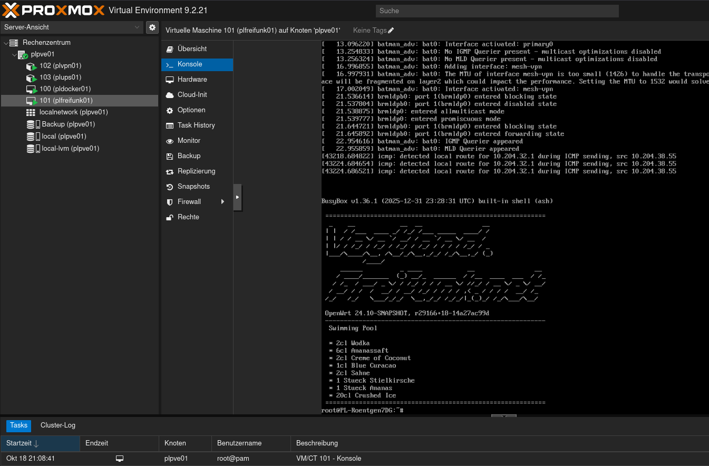
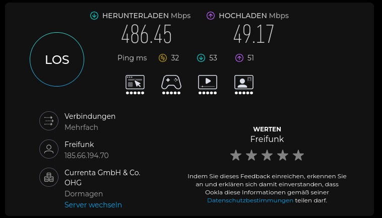

# Freifunk Vogtland Gluon-Offloader als VM unter Proxmox installieren

## 1. Ziel und Netzwerkaufbau

Diese Anleitung beschreibt die Installation eines Freifunk-Vogtland-Gluon-Offloaders als virtuelle Maschine unter Proxmox VE.

Die VM verwendet in meinem Fall zwei virtuelle Netzwerkkarten:

- `eth0`: Client-/Mesh-Seite, VLAN 30
- `eth1`: WAN-Seite, untagged/native VLAN 1

Proxmox übernimmt die VLAN-Zuordnung. Gluon verwendet weiterhin `eth0` für `br-client` und `eth1` für `br-wan`.

## 2. Voraussetzungen

- Zwei virtuelle Netzwerkkarten
- Netzwerkhardware mit VLAN-Unterstützung
- Internetzugang auf dem Proxmox-Host
- Freifunk-Vogtland-Gluon-Image für x86-64

Beispielwerte:

| Einstellung | Wert |
|---|---|
| VM-ID | `<FREIE ID>` |
| VM-Name | `<NAME>` |
| RAM | 1024 MB |
| CPU-Kerne | 2 |
| Bridge | `vmbr0` |
| Client-VLAN | 30 |
| WAN-VLAN | 1, untagged |

## 3. Gluon-Image herunterladen

Alle Befehle in diesem Abschnitt werden auf der Proxmox-Shell als `root` ausgeführt.

    cd /tmp

    wget https://firmware.freifunk-vogtland.net/firmware/stable/factory/gluon-ffv-b20260506-x86-64.img.gz

Download prüfen:

    ls -lh /tmp/gluon-ffv-b20260506-x86-64.img.gz
    gzip -t /tmp/gluon-ffv-b20260506-x86-64.img.gz

Image entpacken:

    gzip -dc /tmp/gluon-ffv-b20260506-x86-64.img.gz \
      > /tmp/gluon-ffv-b20260506-x86-64.img

Größe prüfen:

    ls -lh /tmp/gluon-ffv-b20260506-x86-64.img

Hinweis: Vor einer neuen Installation prüfen, ob eine neuere stabile Firmware für Freifunk Vogtland verfügbar ist. Bei Integritätswarnungen die Datei vor der Verwendung überprüfen.

## 4. VM erstellen

Vorhandene VM-IDs prüfen:

    qm list

Sicherstellen, dass VM-ID `101` nicht bereits für eine andere VM verwendet wird.

Neue VM erstellen:

    qm create <FREIE ID> \
      --name <NAME> \
      --memory 1024 \
      --cores 2 \
      --ostype l26 \
      --net0 virtio=BC:24:11:1E:C5:8A,bridge=vmbr0,tag=30 \
      --net1 virtio=BC:24:11:4C:4C:82,bridge=vmbr0

Die MAC-Adressen sind Beispiele für diese Installation. Bereits verwendete MAC-Adressen sollten bei einer bestehenden VM beibehalten werden. Bei einer neuen VM müssen sie eindeutig sein.

Die Netzwerkkarten sind folgendermaßen zugeordnet:

- `net0`: VLAN 30, Client-/Mesh-Seite
- `net1`: untagged, WAN-Seite über VLAN 1

## 5. Image in Proxmox importieren

    qm importdisk 101 \
      /tmp/gluon-ffv-b20260506-x86-64.img \
      local-lvm

Anschließend die VM-Konfiguration prüfen:

    qm config 101

Die importierte Disk wird zunächst normalerweise als `unused0` angezeigt. Den tatsächlichen Disk-Namen aus der Ausgabe verwenden.

Beispiel:

    unused0: local-lvm:vm-101-disk-0

Disk als virtuelle Boot-Disk einbinden:

    qm set 101 --virtio0 local-lvm:vm-101-disk-0

Bootreihenfolge festlegen:

    qm set 101 --boot order=virtio0

Anschließend kontrollieren:

    qm config 101

Die importierte Disk muss als `virtio0` eingebunden sein.

Falls eine alte Disk vorhanden ist, diese erst entfernen, nachdem die neue Disk erfolgreich importiert, eingebunden und geprüft wurde.

## 6. VM starten

    qm start 101

Die VM-Konsole in der Proxmox-Weboberfläche öffnen und warten, bis Gluon vollständig gestartet ist.

  
   
  <em>Offloader in Proxmox VE 9.2.21</em>

## 7. Netzwerkzuordnung in Gluon prüfen

Per SSH oder VM-Konsole anmelden und ausführen:

    ip link

Erwartete Zuordnung:

- `eth0` ist Mitglied von `br-client`
- `bat0` ist Mitglied von `br-client`
- `eth1` ist Mitglied von `br-wan`

Zusätzlich prüfen:

    ip route

Die WAN-Seite sollte eine passende IP-Adresse aus dem Heimnetz und eine Standardroute über den Heimrouter besitzen.

Beispiel:

    default via 10.0.1.254 dev br-wan

Die konkrete IP-Adresse und das Gateway können je nach Netzwerk abweichen.

  
   
  <em>SSH-Zugriff auf den Offloader.</em>

## 8. WAN-Verbindung testen

Anschließend einen externen IP-Endpunkt testen:

    ping -c 3 1.1.1.1

Wenn der externe Ping funktioniert, ist die grundlegende WAN-Verbindung vorhanden.

Der erfolgreiche Ping allein bestätigt jedoch noch nicht, dass der Freifunk-VPN-Tunnel oder der Client-Datenpfad korrekt funktioniert.

  
   
  <em>Speedtest über LAN bei einer CPU-Auslastung von ca. 22 % auf dem Offloader. Theoretisch verfügbare Internetbandbreite: ca. 500 Mbit/s Download und 50 Mbit/s Upload.</em>

## 9. Konfiguration des Offloader

Weitere Informationen findest du unter
[3. Zugriff und Konfiguration des Knotens](../physical/README.md#3-zugriff-und-konfiguration-des-knotens).

## 10. Weiterführende Links

- [Freifunk Lippe: Freifunk-Offloader mit Proxmox](https://freifunk-lippe.de/neuigkeiten/freifunk-offloader-mit-proxmox/)
- [Freifunk Bremen: Offloader mit Fujitsu Futro](https://wiki.bremen.freifunk.net/Anleitungen/Offloader/Offloader-Futro)