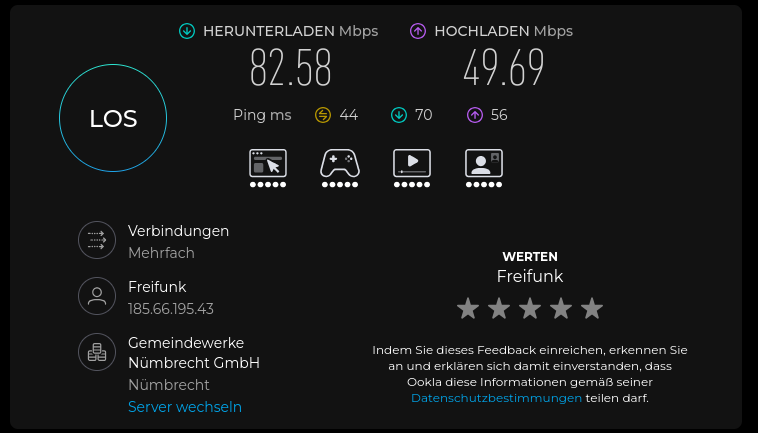
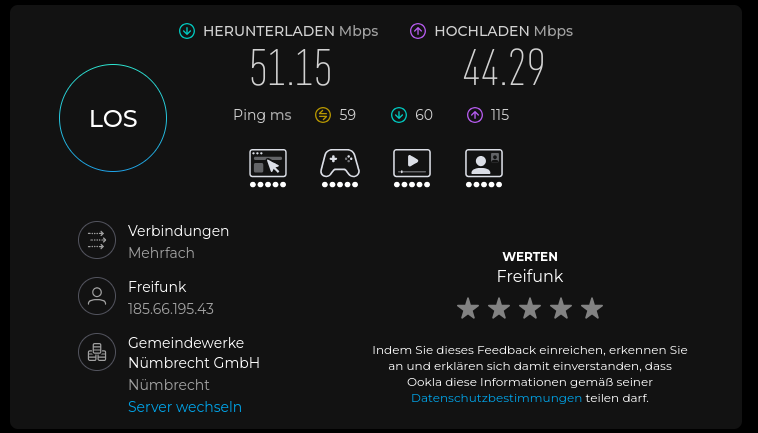

# AVM FRITZ!Box 4020

Die AVM FRITZ!Box 4020 ist ein kompakter WLAN-Router aus dem Jahr 2015. Das Gerät besitzt vier 100-Mbit/s-LAN-Ports sowie einen 100-Mbit/s-WAN-Port und eignet sich daher insbesondere für Anschlüsse und Freifunk-Knoten mit entsprechend geringerer Bandbreite.

### Technische Daten

| Eigenschaft | FRITZ!Box 4020 |
|---|---|
| Erscheinungsjahr | 2015 |
| Ethernet | 4 × LAN + 1 × WAN, jeweils 100 Mbit/s |
| WLAN | 2,4 GHz, IEEE 802.11b/g/n |
| Maximale WLAN-Bruttorate | bis zu 450 Mbit/s |
| 5-GHz-WLAN | Nein |
| WLAN-Standard | Wi-Fi 4 / 802.11n |
| USB | 1 × USB 2.0 |
| CPU | Qualcomm Atheros QCA9561 |
| Freifunk | Gluon-Unterstützung vorhanden |

Die WLAN-Angabe von bis zu 450 Mbit/s ist eine **theoretische Bruttodatenrate**. In der Praxis liegt der tatsächlich erreichbare Datendurchsatz deutlich darunter. Zusätzlich wird die Geschwindigkeit bei einer kabelgebundenen Verbindung durch die 100-Mbit/s-Ethernet-Ports begrenzt.

**Hinweis zur Leistung:** Die FRITZ!Box 4020 kann über ihre Ethernet-Schnittstellen technisch maximal 100 Mbit/s übertragen. Ein Speedtest über LAN kann daher unabhängig von der verfügbaren Internetbandbreite nicht wesentlich über diesem Wert liegen. Auch bei einem Internetanschluss mit höherer Geschwindigkeit stellt die FRITZ!Box 4020 somit einen Flaschenhals dar.

Für die Installation und Einrichtung der FRITZ!Box 4020 im Freifunk Vogtland dienten folgende Quellen als Grundlage:

- **Installationsanleitung:** [Freifunk mit der Fritz!Box 4020 – Freifunk Hennef](https://github.com/Freifunk-Hennef/router-howto/blob/master/Freifunk%20mit%20der%20Fritz!Box4020.pdf)
- **Benötigte Werkzeuge:** [fritz-tools – Releases](https://github.com/freifunk-gluon/fritz-tools/releases)

Die Installation wurde anhand dieser Quellen durchgeführt und überprüft. Das `fritz-tools`-Projekt enthält unter anderem eine automatische Hardware-Erkennung und die passende Gluon-Image-Auswahl für die FRITZ!Box 4020.

## 1. Leistung testen

<p align="center">
  
  <br>
  <sub><em>Speedtest über LAN. Die FRITZ!Box 4020 ist aufgrund ihrer 100-Mbit/s-Ethernet-Ports auf diese Schnittstellengeschwindigkeit begrenzt. Theoretisch verfügbare Internetbandbreite: ca. 100 Mbit/s Download und 50 Mbit/s Upload.</em></sub>
</p>

<p align="center">
  
  <br>
  <sub><em>Speedtest über WLAN. Die FRITZ!Box 4020 nutzt 2,4-GHz-WLAN nach 802.11n. Theoretisch verfügbare Internetbandbreite: ca. 100 Mbit/s Download und 50 Mbit/s Upload.</em></sub>
</p>

## 2. Konfigurationsmodus öffnen

### Schritt 1

Die **WPS-Taste für ca. 10 Sekunden gedrückt halten**, um den Konfigurationsmodus der FRITZ!Box zu öffnen.

### Schritt 2

Dem Client eine IP-Adresse im Netzwerk `192.168.1.0/24` zuweisen.

Beispiel:

```text
IP-Adresse: 192.168.1.2
Netzmaske: 255.255.255.0
```

Die Freifunk-FRITZ!Box ist unter `192.168.1.1` erreichbar.

### Schritt 3

Im Browser folgende Adresse aufrufen:

```text
http://192.168.1.1
```